# DSH Copy Image Menu

在 DeepSeek Harness Web UI 的助手消息复制按钮旁，增加一个 **下载 PNG** 图标按钮。

原生复制按钮保持原样：它继续复制 Markdown，不弹菜单，也不被插件接管。下载按钮只负责把当前助手消息渲染成一张适合分享的 PNG。


> 这是一个客户端插件，所有渲染和下载都在浏览器本地完成。不会上传消息内容。

---

## 功能

- 在助手消息的原生复制按钮旁增加一个下载图标按钮。
- 点击下载按钮，把当前助手消息渲染成 PNG 并下载。
- 不改变原生复制按钮的行为，Markdown 复制仍由 DSH 自己处理。
- 保留 Markdown 的标题、段落、列表、引用、表格、链接、行内代码和代码块样式。
- 使用当前主题的计算样式，深色/浅色主题都能生成接近界面的图片。
- 行内代码默认不拆行，避免 `180px`、`Ctrl+Shift+R` 被断成两截。
- 自动检测内容的横向溢出并加宽画布（最多 2000px），减少复杂卡片、表格或长链接在右侧被截断。
- 图片按最多 2 倍分辨率导出，长消息会自动缩放，避免超过 Canvas 尺寸限制。
- 样式渲染失败时自动回退为纯文本 PNG。
- 下载按钮有四种状态：空闲、生成中、完成、失败。
- 界面文案支持简体中文和英文。

## 界面

```text
助手消息
─────────────────────────────────────
  [复制]  [下载 PNG]  [反馈]  [分支]      19:42
```

下载按钮使用与原生操作行一致的 28px 尺寸、17px 图标、主题色和 hover 背景。它的 `aria-label` / `title` 会在生成中、完成和失败时变化。

---

## 安装

### 环境

- DeepSeek Harness Web UI
- 已在 DSH `0.2.1-rc.2` / Chromium 上测试
- 插件安装依赖 DSH 自带的插件管理器（底层使用 pnpm）

### 从 GitHub 安装

```bash
dsh plugin add "github:gghyoo/dsh-copy-image-menu"
```

安装完成后刷新 Web UI。如果按钮没有出现，打开 **Settings → Plugins**，确认 `@local/dsh-copy-image-menu` 已启用，然后硬刷新页面。

### 从本地目录安装

```bash
git clone https://github.com/gghyoo/dsh-copy-image-menu.git
cd dsh-copy-image-menu
dsh plugin add "$PWD"
```

### 更新

```bash
dsh plugin add "github:gghyoo/dsh-copy-image-menu"
```

或者重新拉取本地目录后刷新页面。插件是纯 JavaScript，没有构建步骤。

### 卸载

```bash
dsh plugin remove "@local/dsh-copy-image-menu"
```

安装或卸载后，建议刷新浏览器页面；如果 DSH 提示需要重启，按提示重启。

---

## 使用

1. 找到一条已完成的助手消息。
2. 把鼠标移到消息下方，复制按钮旁会出现下载图标。
3. 点击下载图标。
4. 浏览器下载 `dsh-message-<时间戳>.png`。

PNG 只包含助手消息正文，不包含点赞、分支、时间、Token 用量等操作栏。

---

## 工作方式

```mermaid
flowchart LR
  A[点击复制按钮旁的下载图标] --> B[找到当前 turn-tail]
  B --> C[克隆最后一条 assistant-step]
  C --> D[内联计算样式]
  D --> E[图片资源转 data URL]
  E --> F[检测横向溢出并加宽]
  F --> G[SVG foreignObject]
  G --> H[base64 data URL 载入]
  H --> I[Canvas 绘制]
  I --> J[PNG Blob]
  J --> K[浏览器下载]
```



### 1. 通过 Slot 添加按钮

插件注册的是 DSH 的助手消息操作行 Slot：

```js
ctx.slots.inject('conversation.chat.assistant-actions', () => ctx.slots.register({
  name: 'conversation.chat.assistant-actions',
  id: 'download-image',
  order: 5,
  locale: NS,
}, DownloadAction));
```

这个 Slot 由 DSH 渲染在已定稿助手消息的 `IconActions` 行内。插件使用 `order: 5`，所以按钮出现在：

```text
原生复制按钮 → 下载按钮 → 反馈 → 分支
```

原生复制按钮不在 Slot 里，因此插件不拦截它，也不重新实现 Markdown 复制。

### 2. 找到当前消息

下载按钮自带一个 ref。点击时：

```js
const tail = buttonRef.current?.closest('[data-turn-tail]');
const target = findAssistantStep(tail);
```

`findAssistantStep()` 会向前查找最后一个 `assistant-step`，这样只会截取最终回复，不会把工具调用、思考过程或操作栏画进去。

### 3. 生成 PNG

生成流程尽量保持轻量：

1. 克隆 `assistant-step` 节点。
2. 把每个元素的计算样式内联到克隆节点里。
3. 将图片资源转换成 data URL，避免生成图片时依赖外部资源。
4. 检测子元素的右边界和 `scrollWidth`，按需加宽画布。
5. 用 SVG `foreignObject` 包住克隆内容。
6. 把 SVG 转成 **base64 data URL**，而不是 Blob URL。
7. 用 `Image` 载入 SVG，再绘制到 Canvas。
8. 通过 `canvas.toBlob()` 导出 PNG 并触发下载。

这里有一个容易踩的坑：把包含 `foreignObject` 的 SVG 用 Blob URL 载入后，Chromium 会把 Canvas 标记为 tainted，随后 `toBlob()` 抛出：

```text
SecurityError: Tainted canvases may not be exported.
```

因此代码使用 base64 data URL。

### 4. 横向溢出

复杂卡片、表格或长链接可能比聊天列更宽。插件会测量克隆内容中每个元素的实际右边界，并参考 `scrollWidth`：

- 如果内容超出当前宽度，就把画布加宽；
- 最多扩展到 2000 CSS px；
- 最多重新布局 3 次；
- 这样避免右侧内容被 Canvas 直接裁掉。

### 5. 行内代码不拆行

对于非 `pre` 内的短行内 `code`（不超过 40 个字符），插件会强制：

```css
white-space: nowrap;
overflow-wrap: normal;
word-break: normal;
```

避免 `180px`、`Ctrl+Shift+R` 这类短代码在图片里被拆成两行。长行内代码仍然允许换行，防止撑破图像。

### 6. 纯文本兜底

如果复杂消息导致 `foreignObject` 渲染失败，插件会退化为纯文本 Canvas：

- 提取助手消息的 `innerText`；
- 按图像宽度逐字换行；
- 生成一张可下载的 PNG。

样式会有损失，但不会直接报「生成图片失败」。

---

## 为什么是下载 PNG，不是复制图片？

浏览器只有在 **安全上下文**（HTTPS 或 `localhost`）下才允许 `navigator.clipboard.write()` 写入 `image/png`。当前 DSH 如果通过 `http://局域网IP:端口` 访问，`navigator.clipboard` 通常不可用。

之前尝试过用选区 + `document.execCommand('copy')` 兜底，但 Chromium 实际只写入 `text/html`，微信、钉钉等桌面应用不会把它当作图片粘贴。为避免「提示复制成功、实际粘不出来」，现在只提供可靠的 **下载 PNG**。

如果后续在 HTTPS 或 localhost 环境下增加图片剪贴板能力，可以复用现有的 PNG Blob，再调用：

```js
await navigator.clipboard.write([
  new ClipboardItem({ 'image/png': blob })
]);
```

---

## 兼容性与限制

- 只处理助手消息，不修改用户消息的复制按钮。
- 依赖 DSH 当前的 DOM 标记（`data-turn-tail`、`data-chat-flow-kind="assistant-step"`）。如果上游 UI 大改，选择器可能需要同步更新。
- 复杂交互组件（例如 Canvas 图表、iframe、Shadow DOM、部分第三方 Widget）在 PNG 中可能只呈现静态外观或空白；纯文本兜底不会保留这些组件。
- 内容宽度最多扩展到 2000 CSS px；超过这个宽度的极端内容仍可能被裁切。
- 超长消息会缩放到 Canvas 限制内，极长内容可能被截断。
- 生成图片在浏览器本地完成，不上传消息内容；但如果消息里包含远程图片，插件会尝试 `fetch` 这些图片并转成 data URL，以便嵌入 PNG。
- 插件不发布到 npm；从 GitHub 或本地目录安装。
- 建议使用 Chromium 内核浏览器；Safari/Firefox 的 `foreignObject` 和字体渲染可能有差异。

---

## 项目结构

```text
.
├── client.js            # 浏览器端：下载按钮、PNG 渲染
├── index.js             # Host 端占位
├── cordis.patch.yml     # DSH bundle patch
├── package.json
├── locale/
│   ├── zh.json          # 插件市场/设置页元数据
│   └── en.json
├── assets/
│   └── icon-180.png     # 市场卡片图标
├── icon.svg
├── LICENSE
└── README.md
```

Host 端没有业务逻辑，所有功能都在 `client.js`。

---

## 开发

### 语法检查

```bash
node --check client.js
node --check index.js
node -e "JSON.parse(require('fs').readFileSync('package.json','utf8'))"
```

### 本地安装调试

```bash
dsh plugin add "$PWD"
```

修改 `client.js` 后，硬刷新浏览器页面（`Ctrl+Shift+R`）让新的客户端代码生效。

### 调试图片渲染

生成失败时，浏览器控制台会输出：

```text
copy-image-menu: download render failed ...
```

如果样式渲染失败并走了纯文本兜底，会输出：

```text
copy-image-menu: styled render failed, using text fallback ...
```

---

## 隐私

- 不上传消息、图片或会话内容。
- 不包含遥测、统计或外部字体请求。
- 只在用户点击下载按钮后读取当前消息 DOM。
- 生成的 PNG 只通过浏览器下载 API 保存到本地。

---

## FAQ

### 下载按钮没有出现？

1. 确认插件已启用：**Settings → Plugins → @local/dsh-copy-image-menu**。
2. 硬刷新页面。
3. 确认消息是已完成的助手消息；按钮在 hover 操作行里。
4. 查看浏览器控制台是否有插件加载错误。

### 下载的图片里代码被拆行？

请确认插件版本包含行内代码 `nowrap` 修复，并硬刷新页面。短行内代码（≤40 字符）默认不拆行。

### 图片右侧被裁切？

插件会自动检测横向溢出并加宽画布，最多 2000 CSS px。如果仍有裁切，把实际 PNG 发到 issue，附上消息内容和 DSH 版本。

### 为什么图片和界面不是 100% 一致？

图片渲染使用克隆 DOM + 计算样式 + Canvas。字体度量、复杂组件、跨域图片和浏览器渲染差异都可能造成细微差别。纯文本兜底只保证内容可读，不保证样式一致。

### 可以复制图片而不是下载吗？

在当前 HTTP 访问方式下不可靠。浏览器会限制图片剪贴板写入；微信/钉钉也不会把 HTML 兜底当成图片。下载 PNG 是当前版本稳定支持的方式。

---

## English Summary

DSH Copy Image Menu adds a **Download PNG** icon button next to the native assistant message copy button in the DeepSeek Harness Web UI. The native copy button is left untouched and still copies Markdown.

On click, the plugin clones the final assistant message, inlines its computed styles, expands the canvas for horizontal overflow, serializes it through SVG `foreignObject` and a base64 data URL, and exports a PNG through Canvas. The plugin has no server-side logic and uploads nothing.

Install:

```bash
dsh plugin add "github:gghyoo/dsh-copy-image-menu"
```

---

## License

[MIT](./LICENSE)
