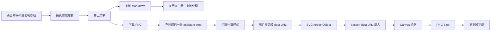

# DSH Copy Image Menu

给 DeepSeek Harness Web UI 的助手消息复制按钮加一个小菜单：

- **复制 Markdown**：复用 DSH 自带的复制逻辑，保留原始文本。
- **下载 PNG**：把当前助手消息渲染成一张适合分享的 PNG 图片。


> 这是一个客户端插件，所有渲染和下载都在浏览器本地完成。不会上传消息内容。

---

## 功能

- 点击助手消息下方的原生复制按钮，弹出「复制 Markdown / 下载 PNG」菜单。
- 复制 Markdown 走宿主原有的复制按钮逻辑，不重新实现文本提取，避免格式丢失。
- 下载 PNG 时渲染当前助手消息，而不是整个会话：
  - 保留 Markdown 的标题、段落、列表、引用、表格、链接、行内代码和代码块样式。
  - 使用当前主题的计算样式，深色/浅色主题都能生成接近界面的图片。
  - 行内代码默认不拆行，避免 `180px`、`Ctrl+Shift+R` 被断成两截。
  - 图片按最多 2 倍分辨率导出，长消息会自动缩放，避免超过 Canvas 尺寸限制。
- 自动检测内容的横向溢出并加宽画布，减少复杂卡片、表格或长链接在图片右侧被截断。
  - 样式渲染失败时自动回退为纯文本 PNG，尽量保证仍然可以下载。
- 界面文案支持简体中文和英文。
- 菜单宽度固定为 180px，尽量贴近 DSH 原生菜单的视觉密度。

## 界面

```text
┌────────────────────────┐
│  ▤  复制 Markdown      │
│     保留原始文本格式   │
│                        │
│  ↓  下载 PNG           │
│     保存为图片文件     │
└────────────────────────┘
```

菜单从助手消息的原生复制按钮旁弹出；它不会出现在用户消息的复制按钮旁。

---

## 安装

### 环境

- DeepSeek Harness Web UI
- 已在 DSH `0.2.1-rc.2` / Chromium 上测试
- 插件安装依赖 DSH 自带的插件管理器（底层使用 pnpm）

### 从 GitHub 安装

```bash
dsh plugin add "github:gghyoo/dsh-copy-image-menu"
```

安装完成后刷新 Web UI。如果菜单没有出现，打开 **Settings → Plugins**，确认 `@local/dsh-copy-image-menu` 已启用，然后硬刷新页面。

### 从本地目录安装

```bash
git clone https://github.com/gghyoo/dsh-copy-image-menu.git
cd dsh-copy-image-menu
dsh plugin add "$PWD"
```

### 更新

```bash
dsh plugin add "github:gghyoo/dsh-copy-image-menu"
```

或者重新拉取本地目录后刷新页面。插件是纯 JavaScript，没有构建步骤。

### 卸载

```bash
dsh plugin remove "@local/dsh-copy-image-menu"
```

安装或卸载后，建议刷新浏览器页面；如果 DSH 提示需要重启，按提示重启。

---

## 使用

1. 找到一条已完成的助手消息。
2. 点击消息下方的复制图标。
3. 选择：
   - **复制 Markdown**：复制这条回复的 Markdown 原文。
   - **下载 PNG**：下载 `dsh-message-<时间戳>.png`。

PNG 只包含助手消息正文，不包含点赞、分支、时间、Token 用量等操作栏。

---

## 工作方式



### 1. 复制按钮拦截

DSH 的原生复制按钮不在可替换的 Slot 中，因此插件在 `document` 的捕获阶段监听点击，只识别：

```text
[data-turn-tail] [data-clock="end"] 里的第一个 button
```

这样只会接管助手消息的复制按钮，不会影响用户消息、分支按钮和反馈按钮。插件通过 `shell.overlay` Slot 渲染菜单，使用 DSH 的主题变量和双语 locale。

### 2. 复制 Markdown

菜单里的「复制 Markdown」不会自己解析 DOM，而是：

1. 关闭菜单；
2. 用插件内部的绕过标记重新触发原生复制按钮；
3. 让 DSH 自己的复制逻辑写入剪贴板。

这样复制出来的文本与未安装插件时完全一致。

### 3. 生成 PNG

生成流程尽量保持轻量：

1. 找到当前消息之前的最后一个 `assistant-step`。
2. 克隆该节点。
3. 把每个元素的计算样式内联到克隆节点里。
4. 将图片资源转换成 data URL，避免生成图片时依赖外部资源。
5. 用 SVG `foreignObject` 包住克隆内容。
6. 把 SVG 转成 **base64 data URL**，而不是 Blob URL。
7. 用 `Image` 载入 SVG，再绘制到 Canvas。
8. 通过 `canvas.toBlob()` 导出 PNG 并触发下载。

这里有一个容易踩的坑：把包含 `foreignObject` 的 SVG 用 Blob URL 载入后，Chromium 会把 Canvas 标记为 tainted，随后 `toBlob()` 抛出：

```text
SecurityError: Tainted canvases may not be exported.
```

因此代码使用 base64 data URL。这个改动解决了浏览器里「生成图片失败」的主要问题。

### 4. 行内代码不拆行

克隆 DOM 时，对于非 `pre` 内的短行内 `code`（不超过 40 个字符），插件会强制：

```css
white-space: nowrap;
overflow-wrap: normal;
word-break: normal;
```

避免 `180px`、`Ctrl+Shift+R` 这类短代码在图片里被拆成两行。长行内代码仍然允许换行，防止撑破图像。

### 5. 纯文本兜底

如果复杂消息导致 `foreignObject` 渲染失败，插件会退化为纯文本 Canvas：

- 提取助手消息的 `innerText`；
- 按图像宽度逐字换行；
- 生成一张可下载的 PNG。

样式会有损失，但不会直接报「生成图片失败」。

---

## 为什么是下载 PNG，不是复制图片？

这是有意的设计取舍。

浏览器只有在 **安全上下文**（HTTPS 或 `localhost`）下才允许 `navigator.clipboard.write()` 写入 `image/png`。当前 DSH 如果通过 `http://局域网IP:端口` 访问，`navigator.clipboard` 通常不可用。

早期版本尝试过用选区 + `document.execCommand('copy')` 兜底，但 Chromium 实际只写入 `text/html`，微信、钉钉等桌面应用不会把它当作图片粘贴。为避免「提示复制成功、实际粘不出来」，现在只保留可靠的 **下载 PNG**。

如果后续在 HTTPS 或 localhost 环境下增加图片剪贴板能力，可以复用现有的 PNG Blob，再调用：

```js
await navigator.clipboard.write([
  new ClipboardItem({ 'image/png': blob })
]);
```

---

## 兼容性与限制

- 只处理助手消息，不修改用户消息的复制行为。
- 依赖 DSH 当前的 DOM 标记（`data-turn-tail`、`data-clock="end"`、`data-chat-flow-kind="assistant-step"`）。如果上游 UI 大改，选择器可能需要同步更新。
- 复杂交互组件（例如 Canvas 图表、iframe、Shadow DOM、部分第三方 Widget）在 PNG 中可能只呈现静态外观或空白；纯文本兜底不会保留这些组件。
- 超长消息会缩放到 Canvas 限制内，极长内容可能被截断。
- 生成图片在浏览器本地完成，不上传消息内容；但如果消息里包含远程图片，插件会尝试 `fetch` 这些图片并转成 data URL，以便嵌入 PNG。
- 插件不发布到 npm；从 GitHub 或本地目录安装。
- 建议使用 Chromium 内核浏览器；Safari/Firefox 的 `foreignObject` 和字体渲染可能有差异。

---

## 项目结构

```text
.
├── client.js            # 浏览器端：拦截、菜单、PNG 渲染
├── index.js             # Host 端占位
├── cordis.patch.yml     # DSH bundle patch
├── package.json
├── locale/
│   ├── zh.json          # 插件市场/设置页元数据
│   └── en.json
├── icon.svg
├── LICENSE
└── README.md
```

Host 端没有业务逻辑，所有功能都在 `client.js`。

---

## 开发

### 语法检查

```bash
node --check client.js
node --check index.js
node -e "JSON.parse(require('fs').readFileSync('package.json','utf8'))"
```

### 本地安装调试

```bash
dsh plugin add "$PWD"
```

修改 `client.js` 后，硬刷新浏览器页面（`Ctrl+Shift+R`）让新的客户端代码生效。

### 调整菜单宽度

`client.js` 顶部：

```js
const MENU_WIDTH = 180;
```

菜单的定位逻辑会自动根据这个宽度计算左右位置。

### 调试图片渲染

生成失败时，浏览器控制台会输出：

```text
copy-image-menu: render failed ...
```

如果样式渲染失败并走了纯文本兜底，会输出：

```text
copy-image-menu: styled render failed, using text fallback ...
```

---

## 隐私

- 不上传消息、图片或会话内容。
- 不包含遥测、统计或外部字体请求。
- 只在用户点击复制按钮后读取当前消息 DOM。
- 生成的 PNG 只通过浏览器下载 API 保存到本地。

---

## FAQ

### 菜单没有出现？

1. 确认插件已启用：**Settings → Plugins → @local/dsh-copy-image-menu**。
2. 硬刷新页面。
3. 确认点击的是助手消息下方的复制图标，不是用户消息的复制图标。
4. 查看浏览器控制台是否有插件加载错误。

### 下载的图片里代码被拆行？

请确认插件版本包含行内代码 `nowrap` 修复，并硬刷新页面。短行内代码（≤40 字符）默认不拆行。

### 为什么图片和界面不是 100% 一致？

图片渲染使用克隆 DOM + 计算样式 + Canvas。字体度量、复杂组件、跨域图片和浏览器渲染差异都可能造成细微差别。纯文本兜底只保证内容可读，不保证样式一致。

### 可以复制图片而不是下载吗？

在当前 HTTP 访问方式下不可靠。浏览器会限制图片剪贴板写入；微信/钉钉也不会把 HTML 兜底当成图片。下载 PNG 是当前版本稳定支持的方式。

---

## English Summary

DSH Copy Image Menu is a small client-side plugin for the DeepSeek Harness Web UI. It turns the assistant message copy button into a two-item menu:

- **Copy Markdown** — delegates to the host's original copy handler.
- **Download PNG** — renders the final assistant message to a styled PNG locally.

The plugin has no server-side logic and uploads nothing. It targets Chromium-based browsers and DSH Web UI `0.2.1-rc.2`.

Install:

```bash
dsh plugin add "github:gghyoo/dsh-copy-image-menu"
```

---

## License

[MIT](./LICENSE)
